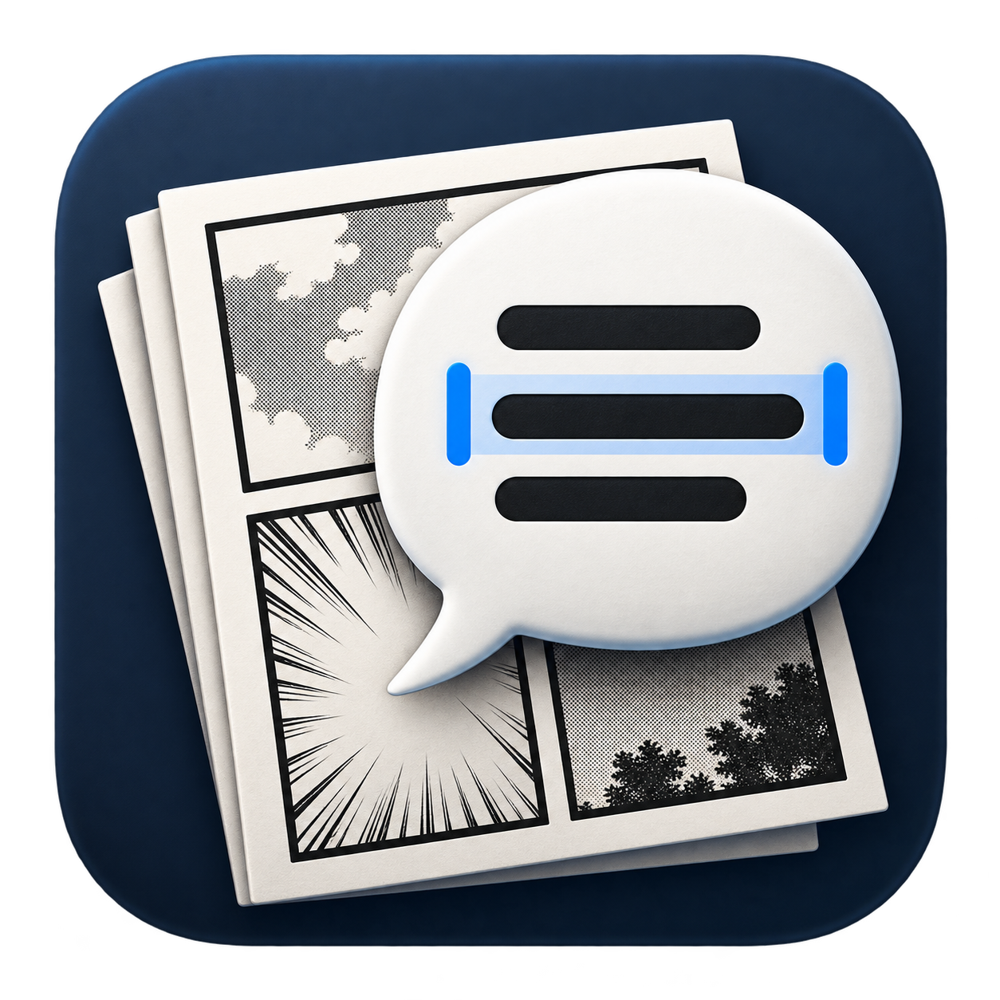

# Inkflow для macOS

Inkflow помогает подготовить перевод манги: увеличить сканы, распознать и проверить реплики, удалить исходные надписи и разместить новый текст поверх страницы.

**Папка сканов → апскейл ×2 → OCR → экспорт TXT и очистка → перевод в Яндексе → раскладка по облачкам → готовый PNG.** Этапы выбираете вы. Перевод также можно импортировать из TXT или ввести вручную.

| Возможность | Что доступно |
|---|---|
| Апскейл | Все изображения главы ×2 через nunif / waifu2x, автоматическая замена рабочих изображений в приложении |
| Распознавание | Локальный Apple Vision OCR, рамки реплик, предварительный порядок чтения |
| Проверка реплик | Редактирование, перестановка, объединение, исключение, удаление и добавление облачков |
| Перевод | Раскладка результата Яндекс Переводчика по репликам, общий шрифт главы и подбор размера в рамках OCR, импорт переведённого TXT |
| Ретушь | Кисть с сохранением текстуры или сглаживанием, настройка размера и отмена мазков |
| Текстовые слои | Автоматические места перевода по рамкам OCR, системные шрифты, жирный и курсив, подчёркивание, зачёркивание, прописные, цвет и интервалы |
| Размещение текста | Перемещение мышью, восемь маркеров рамки, перенос строк, порядок и видимость слоёв |
| Экспорт | TXT главы, PNG отдельной страницы или всей главы с текстом в полном разрешении |
| Сохранение | Автоматическое сохранение проекта рядом со сканами, восстановление рабочих изображений и слоёв |

## Скачать

Готовая сборка для Mac с Apple Silicon находится в [GitHub Releases](https://github.com/Genoshi14X/inkflow/releases/latest). Скачайте ZIP, распакуйте и перенесите **Inkflow.app** в Applications. Python и модели nunif устанавливаются отдельно для апскейла и восстановления фона.

Сборка пока имеет ad-hoc подпись без Developer ID и нотариализации Apple; macOS может заблокировать первый запуск скачанного приложения. Подробности и ограничения указаны в описании релиза.

## Запуск и требования

После [сборки из исходников](#разработка) откройте **`dist/Inkflow.app`** двойным щелчком. Приложение предназначено для Apple Silicon и macOS 13+. Проверено на M1 Pro с macOS 26.5.2; более старые версии macOS отдельно не проверялись.

| Инструмент | Что нужно |
|---|---|
| OCR, проверка реплик, текстовые слои и экспорт | Собранный Inkflow; Python и API-ключи не требуются |
| Апскейл | Отдельная установка [nunif](https://github.com/nagadomi/nunif) с Python, зависимостями и моделями waifu2x |
| Кисть восстановления | Python окружения nunif с `opencv-python-headless` и Pillow |
| Перевод в Яндексе | Браузер и интернет |

OCR, апскейл, ретушь и размещение текста выполняются локально. Для первоначальной установки зависимостей и моделей нужен интернет. При переводе вставленный текст обрабатывается Яндексом; изображения Inkflow туда не отправляет.

## Быстрый сценарий

1. **Откройте папку главы.** Поддерживаются PNG, JPG и JPEG непосредственно в папке. Страницы сортируются по числам в имени: `1, 2, …, 10`.
2. **При необходимости увеличьте сканы.** Нажмите **Апскейл папки ×2**. Готовые варианты автоматически станут рабочими изображениями в Inkflow.
3. **Распознайте и проверьте реплики.** Нажмите **Распознать все страницы**, исправьте текст и порядок. Для последующего импорта перевода экспортируйте TXT и сохраните его карту привязок.
4. **Удалите исходные надписи.** Оставьте включённым **Очистить текст после экспорта** или запустите **Очистить распознанный текст** отдельно. Проверьте страницы с пропусками и при необходимости пройдитесь **Кистью восстановления**.
5. **Подготовьте перевод.** В режиме [Яндекс Переводчик…](#перевод-на-русский-через-браузер) скопируйте оригинал, переведите его в браузере и вставьте русский результат в Inkflow. После проверки приложение разместит текст в связанных слоях. Если уже перевели файл, воспользуйтесь **Импорт перевода TXT…**.
6. **Проверьте текст на странице.** При необходимости переместите слой, увеличьте рамку или исправьте текст во вкладке **Текст на странице**.
7. **Сохраните готовую страницу.** Во вкладке **Текст на странице** нажмите **Экспорт страницы в PNG…**. Файл появится в выбранной папке; по умолчанию — `exports/` внутри главы.

## Распознавание и проверка реплик

**Распознать все страницы** обрабатывает нераспознанные страницы главы по очереди. **Остановить** завершает обработку после текущей страницы. При следующем запуске Inkflow обработает оставшиеся страницы и сохранит ручные правки на уже распознанных.

- Нажатие на рамку поверх изображения выбирает реплику и прокручивает к ней список справа.
- Текст справа можно редактировать; стрелки меняют порядок реплик.
- Снимите **В TXT**, чтобы исключить звук или лишнюю надпись из экспорта.
- В меню `…` доступны объединение со следующей репликой, исходный OCR и удаление блока.
- Если текст пропущен, нажмите **Добавить облачко** и обведите его мышью. Реплика добавится в конец списка; переставьте её стрелками. При неудачном распознавании введите текст вручную.
- Чтобы разделить ошибочно объединённый блок, исключите его и добавьте облачка по отдельности.

После проверки нажмите **Отметить как проверенную**, затем **Экспорт TXT…**. По умолчанию файл называется как папка главы, например `155.txt`. Непроверенные и нераспознанные страницы помечаются в TXT.

## Места перевода из OCR

После распознавания для каждой реплики с включённым **В TXT** автоматически создаётся пустой текстовый слой на месте её OCR-рамки. Размер шрифта предварительно оценивается по исходным строкам; текст перевода можно будет подогнать после вставки. Новые облачка, добавленные вручную, тоже получают связанный слой.

Откройте вкладку **Текст на странице**: пустые места показаны пунктиром и номерами реплик. В списке слоёв видны номер и начало исходного текста. Выберите рамку, чтобы изменить её положение, размер или оформление и ввести перевод. Пустые рамки служебные и **не видны в экспортированном PNG**.

Для уже распознанных глав места создаются при следующем **Экспорте TXT…** или нажатии **Распознать все страницы**. Повторное действие не дублирует слои. Если выбрать реплику и нажать **Добавить текст**, Inkflow откроет её существующее место; при наличии перевода у реплики он вставится в пустой слой.

Слой связан с постоянным ID реплики, поэтому перестановка и исправление OCR не разрывают привязку. Неизменённые пустые рамки следуют за объединением и исключением реплик. Слои с введённым текстом или ручными настройками сохраняются; если исходную реплику удалить, такой слой остаётся самостоятельным. Расположение и оформление, изменённые вручную, повторная подготовка не сбрасывает.

При структурированном TXT-экспорте сохраняются два файла:

- `155.txt` — привычный текст главы с заголовками страниц и номерами реплик; формат не изменён.
- `155.inkflow-map.json` — карта привязки: глава, режим экспорта, страница, номер реплики на момент экспорта, ID реплики и слоя, рамка и исходный текст.

Координаты в карте нормализованы относительно страницы. Карта фиксирует порядок конкретного экспорта: если позже переставить реплики и экспортировать под другим именем, предыдущая карта сохраняет старое соответствие. Храните карту вместе с исходным TXT и проектом — она используется при импорте перевода по местам.

Перевод можно добавить через браузерный режим, [импортировать из TXT](#импорт-перевода-из-txt) или ввести в слой вручную. Свободный черновик можно сохранить отдельным TXT.

## Импорт перевода из TXT

1. Экспортируйте оригинал главы через **Экспорт TXT…**. Сохраните полученные `155.txt` и `155.inkflow-map.json`.
2. Переведите текст и сохраните, например, как `155_ru.txt`. Оставьте имена страниц и номера реплик из исходного экспорта. Кодировка — UTF-8 или UTF-16 с BOM.
3. Откройте исходную главу в Inkflow. Во вкладке **Текст на странице** или меню **File** нажмите **Импорт перевода TXT…**.
4. Выберите переведённый TXT. Если рядом лежит одноимённая карта, приложение использует её; иначе выберите карту исходного экспорта вручную. Например, для `155_ru.txt` обычно нужна `155.inkflow-map.json`.
5. Проверьте реплики и число обновлений. При необходимости включите **Выбрать общий шрифт для импорта** и выберите установленный шрифт с нужным начертанием. Он применяется только к импортируемым репликам; без этой опции сохраняются их прежние шрифты. Затем нажмите **Импортировать**.

Пример файла перевода:

```text
Глава 155

=== Страница 01.png ===

[01]
Первая переведённая реплика.

[02]
Вторая реплика.
Продолжение той же реплики на новой строке.

=== Страница 02.png ===

[01]
Первая реплика следующей страницы.
```

Нумерация начинается заново на каждой странице. Допускается текст сразу после номера, например `[01] Привет!`. Поддерживается и двуязычный формат с `EN:` и `RU:`: импортируется содержимое RU. Служебные отметки Inkflow о непроверенном тексте и переводе пропускаются.

Карта сопоставляет номера исходного экспорта с постоянными ID реплик. Даже если после экспорта реплики переставили, перевод попадает в связанные с ними слои. Положение, шрифт, оформление и видимость существующих слоёв сохраняются. Удалённый слой при необходимости восстанавливается по рамке из карты. Для удаления исходных надписей используйте пакетную очистку или кисть.

### Проверка и замена текста

- По умолчанию уже заполненный текст сохраняется. Если в слое или переводе OCR есть другая версия, реплика помечается как конфликтующая и пропускается.
- Чтобы заменить такие версии, выберите **Заменить текст переводом из файла** в окне проверки.
- Если в TXT отсутствует часть реплик, приложение покажет номера. Для загрузки только имеющейся части включите **Импортировать неполный перевод**. Остальные слои не меняются.
- Пустые переводы, повторные номера, неизвестные страницы или номера и несовместимая карта останавливают подготовку импорта. Исправьте TXT или выберите правильную карту; проект при проверке не меняется.
- Если исходный OCR-текст после экспорта был исправлен, появится предупреждение для сверки перевода. Если реплика удалена или исключена, импорт её перевода не выполняется.

Перевод записывается и в текстовый слой, и в поле перевода соответствующей реплики OCR. Черновик браузерного перевода остаётся отдельным. Изменения сохраняются с главой; весь импорт отменяется одной правкой через `⇧⌘Z`. Повторный импорт того же текста не создаёт дубликатов. После загрузки проверьте переносы строк и размеры рамок, затем экспортируйте PNG.

Для TXT из старой версии без карты сначала подготовьте карту экспортом из того же проекта и сверьте соответствие страниц и номеров старому файлу. Автоматически восстановить прежнюю нумерацию после перестановок без исходной карты нельзя.

## Апскейл ×2 через nunif

Нажмите **Апскейл папки ×2** над изображением. Все страницы открытой главы обрабатываются по очереди с прогрессом. После каждой страницы улучшенный PNG становится её рабочим изображением: просмотр, OCR и дальнейшие правки используют новый вариант.

Порядок страниц, реплики, переводы и текстовые слои сохраняются. Положение и типографика слоёв масштабируются пропорционально изображению. Отметки проверки снимаются; история отмены очищается при замене рабочих изображений.

Результаты сохраняются в `upscaled/<идентификатор запуска>/<имя исходника>_x2.png` внутри папки главы. Оригиналы остаются на диске. При остановке или ошибке готовые страницы остаются улучшенными, остальные — в прежнем виде. **Повторное нажатие увеличивает все текущие рабочие изображения ещё вдвое.**

Inkflow автоматически ищет `~/Downloads/nunif` и Python в `.venv/bin/python` или `venv/bin/python`. Если установка не найдена, приложение предложит выбрать папку nunif и Python его окружения. Выбор сохраняется; запуск из Finder поддерживается.

Для каждой страницы передаются фиксированные параметры:

```sh
python -m waifu2x.cli -i input -o output --method scale2x --noise-level 1 --format png
```

Работа идёт в фоне; **Остановить** прерывает процесс. Inkflow проверяет успешное завершение и удвоение размеров изображения. Модели и зависимости автоматически не устанавливаются.

## Очистка исходных надписей

Переключатель **Очистить текст после экспорта** находится рядом с кнопкой **Экспорт TXT…** и по умолчанию включён. Его состояние запоминается. Сначала Inkflow сохраняет TXT и карту `.inkflow-map.json`, затем обрабатывает распознанные страницы всей главы. Если экспорт не удался или был отменён, очистка не запускается.

Чтобы очистить главу отдельно, нажмите **Очистить распознанный текст** в меню рядом с **Экспорт TXT…** или в меню **File**. Команда доступна и до экспорта.

- Обрабатываются только найденные OCR области, включённые в TXT. Исключённые реплики остаются на изображении. Режим TXT (оригинал, перевод, EN + RU) не меняет области очистки.
- Внутри областей строится маска контрастных букв с небольшим запасом для сглаженных краёв. Прямоугольник целиком не закрашивается. Для новых сканов сохраняются также координаты отдельных строк, чтобы не трогать промежутки между ними. Старые проекты используют рамку реплики и число строк исходного OCR.
- На однотонном фоне применяется сглаженное восстановление, на текстуре — подбор соседних фрагментов с сохранением зерна. Другие найденные надписи исключаются из источников текстуры.
- Области, где маску или фон нельзя надёжно определить, пропускаются. Кнопка **Страницы с пропусками** внизу окна показывает, где проверить результат. Крупные звуки обрабатываются, если их нашёл OCR. Сложные пересечения с рисунком могут потребовать кисти.

Работа идёт в отдельном Python-процессе с прогрессом по страницам. **Остановить** прерывает очистку. Все готовые изображения подставляются в приложение только после успешной обработки и сохранения всей главы. При остановке или ошибке промежуточная папка удаляется, прежние рабочие изображения остаются активными, TXT и карта сохраняются.

Результаты записываются в `cleaned/<ID>/` внутри главы. Используется текущее рабочее изображение, включая апскейл и предыдущую ретушь. Размер страницы и прозрачность сохраняются. Текст OCR, переводы, рамки и оформление текстовых слоёв не меняются. Добавленные текстовые слои остаются поверх очищенного растра.

Всю очистку можно отменить одной правкой через **Отменить правку Inkflow** (`⇧⌘Z`). Исходники и предыдущие версии изображений сохраняются. Повторный экспорт без изменений не запускает повторную очистку тех же областей; отметка сохраняется в проекте. Чтобы только выгрузить TXT, выключите переключатель перед экспортом.

Используется тот же Python, что и для кисти/nunif, с пакетами `opencv-python-headless` и `Pillow`. Дополнительная нейросеть не требуется. Автоматическое выделение букв работает по контрасту и форме: это не гарантирует точного восстановления скрытых деталей рисунка. Проверьте результат и доработайте сложные места кистью.

## Удаление текста кистью

После подготовки перевода включите **Кисть восстановления** над страницей. Настройте размер в пикселях рабочего изображения, увеличьте масштаб при необходимости и закрасьте надпись целиком с небольшим запасом фона. Восстановление выполняется после отпускания мыши. Одиночный щелчок оставляет круглый мазок; рамки OCR во время ретуши скрыты.

| Режим | Как работает |
|---|---|
| **Сохранять текстуру** — по умолчанию | Подбирает соседние фрагменты по границе мазка и переносит их, сохраняя зерно и растр без усреднения |
| **Сглаживать** | Восстанавливает фон через OpenCV Telea; подходит для ровных облачков, но может размывать растр |

Каждый мазок сохраняется отдельным PNG в `edited/` и сразу становится рабочим изображением. Реплики, переводы и текстовые слои остаются в проекте. Кисть изменяет растровое изображение под слоями; чтобы убрать добавленный текстовый слой, скройте или удалите сам слой.

Стрелка рядом с размером кисти или `⇧⌘Z` отменяет последнюю правку, включая мазок. Текущий результат восстанавливается после открытия главы. Кнопка с папкой показывает рабочий PNG в Finder.

Для кисти установите OpenCV в Python окружения nunif, например:

```sh
~/Downloads/nunif/venv/bin/python -m pip install opencv-python-headless
```

Лучше работать небольшими мазками. В режиме текстуры возможны повторения узора и неточное продолжение линий. Скрытые буквами детали нельзя восстановить точно по одному изображению. Режим применяется к новым мазкам; сохранённые ранее мазки автоматически не пересчитываются. Исходник и предыдущие PNG сохраняются, OCR после стирания автоматически не запускается.

## Текст поверх страницы

Нажмите **Добавить текст** над изображением. Справа откроется вкладка **Текст на странице**. Введите или вставьте перевод, выберите установленный шрифт через поиск и настройте слой. Если перед добавлением выбран блок OCR с переводом, новый слой получит его рамку и перевод.

### Шрифт и форматирование

| Параметр | Действие |
|---|---|
| Шрифт | Поиск среди установленных системных шрифтов и начертаний |
| **B** | Жирный |
| **I** | Курсив |
| **U** | Подчёркивание |
| **S** | Зачёркивание |
| **TT** | Все прописные; исходный регистр в поле ввода сохраняется |
| Размер, px | Размер шрифта в пикселях рабочего изображения |
| Ширина / высота букв, % | Горизонтальное и вертикальное масштабирование букв, от 50 до 200% |
| Межстрочный / межбуквенный, px | Дополнительные интервалы между строками и буквами |
| Выравнивание | Слева, по центру или справа; отдельно — центрирование по высоте блока |
| Цвет | Выбор цвета текста |
| Обводка текста | Включение, толщина в пикселях и цвет; например, белый текст с чёрной обводкой |
| Поворот, ° | Угол поворота всего текстового блока |

Переключатели можно сочетать. **Форматирование применяется ко всему слою.** Разные стили отдельных слов или букв внутри одного слоя пока не поддерживаются.

Для B/I выбирается настоящее начертание шрифта. Если его нет, используется искусственная жирность или наклон с пометкой в панели. Для другой насыщенности, например Light, Medium или Black, выберите соответствующее установленное начертание в списке шрифтов. Выбор начертания обновляет состояния B/I. Если шрифт проекта больше не установлен, Inkflow использует системный и показывает предупреждение.

### Рамка и слои

- Перетащите блок мышью, чтобы переместить текст по странице.
- Тяните угловой маркер рамки для изменения ширины и высоты, боковой — для изменения одной стороны. У рамки восемь маркеров.
- Текст переносится по новой ширине, размер шрифта сохраняется. Если текст не помещается по высоте, появляется подсказка.
- Координаты, размеры и остальные числовые параметры можно менять стрелками рядом с полем или клавишами **↑/↓** при вводе. Шаг — 1; **Shift** увеличивает шаг до 10, **Option** уменьшает до 0,1. Ввод числа подтверждается Enter или переходом к другому полю.
- Тяните круглый маркер над рамкой для поворота текста. **Shift** задаёт шаг 15°. Угол можно ввести и в поле **Поворот, °**.
- Выбирайте слои в списке, скрывайте их, меняйте порядок кнопками **Выше / Ниже** или удаляйте. Новые слои появляются поверх предыдущих.

Перемещение и изменение рамки отображаются сразу, сохраняются после отпускания мыши и отменяются одной правкой. Слои остаются редактируемыми после открытия проекта и сохраняются при апскейле, ретуши и OCR. Поворот и обводка сохраняются в проекте и одинаково применяются в редакторе и PNG. Вертикальный набор пока не поддерживается.

### Экспорт PNG

**Экспорт страницы в PNG…** во вкладке **Текст на странице** сохраняет выбранную страницу с видимыми слоями в полном разрешении, без рамок редактора. Папка по умолчанию — `exports/` внутри главы.

**Сохранить все страницы…** в панели текста или **Сохранить все страницы в PNG…** в меню **File** сохраняет всю открытую главу одной кнопкой. Выберите папку назначения: внутри появится новая папка `Inkflow_PNG_<ID>` с PNG в порядке чтения. Каждая страница использует своё текущее рабочее изображение, включая апскейл и ретушь, и свои видимые слои. Имена имеют префикс порядка, например `0001_01.png_lettered.png`. При остановке или ошибке незавершённая папка удаляется; готовые экспорты не перезаписываются.

Экспорт не меняет рабочее изображение и редактируемые слои. Исходные и рабочие файлы защищены от перезаписи. TXT-экспорт по-прежнему содержит реплики OCR и их переводы, независимо от размещённого поверх страницы текста.

## Перевод на русский через браузер

1. Распознайте главу и проверьте английские реплики и их порядок.
2. Нажмите **Яндекс Переводчик…**, затем **Скопировать оригинал и открыть Яндекс**. Вставьте оригинал в левое поле переводчика.
3. Скопируйте весь результат из правого поля вместе с метками. Вернитесь в Inkflow и нажмите **Вставить перевод из буфера**. Если глава разбита на части, повторите для каждой. Перед вставкой следующей части замените весь текст в левом поле Яндекса.
4. Нажмите **Проверить раскладку**, выберите шрифт и нажмите **Добавить в слои**. Inkflow сохранит выбранный шрифт для главы и подберёт размер каждой добавленной реплики. Ручной перевод сохраняется при конфликте, пока вы явно не выберете замену.

Метки связывают результат с конкретными репликами, даже если порядок OCR изменился. Если Inkflow не распознал метку, сверяйтесь с разделом **Оригинал с метками**. Вставьте результат повторно или исправьте его в поле и нажмите **Проверить часть**. За один раз копируется до 9500 единиц UTF-16. Если одна реплика превышает лимит, используйте импорт TXT. До подтверждения части хранятся в открытом окне перевода.

Если текст не поместился в рамку при размере 12 пикселей, предпросмотр отметит реплику. Сократите перевод в поле с метками или увеличьте рамку после добавления. Весь импорт можно отменить через **Отменить правку Inkflow**.

В разделе **Свободный черновик** можно редактировать ранее сохранённый черновик, добавлять произвольный текст из буфера и сохранять его в RU TXT.

## Сохранение проекта и файлов

**Правки сохраняются автоматически** в скрытом файле `.mangascan.json` внутри папки главы. Имя сохранено для совместимости с первой версией приложения. При повторном открытии исходной папки восстанавливаются реплики, их порядок и переводы, исключённые блоки, отметки проверки, рабочие изображения, текстовые слои и русский черновик.

| Файл или папка | Содержимое |
|---|---|
| Исходные PNG/JPG/JPEG | Оригиналы страниц в корне папки главы |
| `.mangascan.json` | Текст, настройки, слои, связи с репликами OCR и ссылки на рабочие изображения |
| `*.inkflow-map.json` | Карта номеров и текстовых слоёв для соответствующего TXT-экспорта |
| `upscaled/` | Результаты апскейла |
| `edited/` | PNG после мазков кисти, включая предыдущие версии |
| `cleaned/` | Результаты автоматической очистки текста |
| `exports/` | Готовые PNG с текстом, если сохранены в папку по умолчанию |

**Переносите и храните всю папку главы целиком.** Одного `.mangascan.json` недостаточно: рабочие изображения находятся в `upscaled/`, `edited/` и `cleaned/`. Экспортированный PNG — готовая картинка; для дальнейшего редактирования слоёв нужен проект.

Если проект повреждён, Inkflow сообщает об ошибке и не перезаписывает его. Если рабочее изображение изменилось или отсутствует, приложение показывает предупреждение и сохраняет текстовые правки. Папка должна быть доступна для записи.

Формат проекта — версия 2, чтение версии 1 поддерживается. Не сохраняйте проект с новыми слоями и настройками в старой версии Inkflow и не редактируйте одну главу одновременно в нескольких экземплярах приложения.

### Клавиши и отмена

| Клавиши | Действие |
|---|---|
| `⌘O` | Открыть папку |
| `⌘S` | Сохранить проект |
| `⌘E` | Экспорт TXT |
| `⇧⌘Z` | Отменить последнюю правку Inkflow, включая мазок или изменение слоя |

История отмены хранится до закрытия приложения или смены главы. При апскейле она очищается после замены рабочих изображений. Текущий сохранённый результат остаётся в проекте.

## Ограничения распознавания

OCR настроен на английский язык. Панели выделяются по светлым промежуткам: сначала горизонтальные разделители, затем вертикальные с обходом справа налево. Строки объединяются по близости и выравниванию внутри панели. Это геометрическая эвристика, которая требует проверки редактором.

- Нестандартные, вложенные и диагональные панели, развороты и облачка поверх нескольких панелей могут определяться неверно.
- Смысл диалога не анализируется; порядок реплик не всегда восстанавливается одной геометрией.
- Звуки и фоновые надписи нужно исключать из TXT вручную.
- Возможны ошибки букв, пунктуации и имён даже при высокой уверенности OCR. Замены похожих кириллических символов отмечаются предупреждением; исходный текст доступен в меню блока.
- Вложенные папки не обходятся. Изменённые исходники автоматически повторно не распознаются.

## Проверки

Основной набор тестов проверяет распознавание на синтетических изображениях, порядок и редактирование реплик, сохранение, отмену, совместимость проектов, разбивку текста для браузера, пакетный апскейл и текстовые слои.

Для импорта проверены UTF-8/UTF-16, многострочный и двуязычный текст, ошибки структуры, карты после перестановок, частичные файлы, замена и сохранение заполненных слоёв, восстановление удалённых рамок, повторный импорт, отмена и ошибка сохранения.

Для перевода через браузер проверены метки и повторная вставка частей, раскладка по ID, подбор размера кириллицы и предупреждение о переполнении. На синтетической странице с готовыми рамками проверен обмен текстом с Яндексом, очистка и экспорт PNG.

Для мест перевода проверены постоянные ID, повторная подготовка без дубликатов, перестановка и исключение реплик, сохранность ручных слоёв, неизменность формата TXT, карты экспорта и откат карты при ошибке записи TXT.

Для новых инструментов проверены обработка ошибок и остановка, восстановление рабочих изображений после открытия, сохранность переводов и слоёв, перетаскивание и изменение рамки одним жестом, начертания, кириллица, скрытые слои и PNG-экспорт. Проверки кисти через реальный Python запускаются отдельно. Через интерфейс проверены мазки и их отмена, выбор шрифтов, форматирование, маркеры рамки, перемещение текста и экспорт PNG.

### Пять локальных образцов OCR

Результаты — в `output/automatic.json`, сравнение с ручной разметкой — в `output/evaluation.json`. Таблица соответствует локальному прогону 30 октября 2026 года.

| Образец | Найдено размеченных блоков | Всего блоков OCR | Порядок реплик относительно ручного образца |
|---|---:|---:|---|
| 01 | 8/8 | 8 | Совпал |
| 02 | 8/8 | 8 | Совпал |
| 03 | 5/5 | 7 | Совпал |
| 04 | 5/5 | 6 | Совпал |
| 05 | 8/8 | 8 | Требует правки |

Блоки сопоставляются по пересечению рамок (IoU ≥ 0,55); сравнение порядка исключает лишние блоки звуков и фона. **Это не оценка точности букв и не гарантия качества на новых главах.** Пять страниц использовались при разработке. Порядок на странице 05 в ручном образце выбран по смыслу диалога и требует подтверждения редактором.

## Разработка

Swift-приложение использует SwiftUI, AppKit, Vision и ImageIO без сторонних Swift-пакетов. Апскейл и ретушь запускают отдельные Python-процессы.

| Исходник | Назначение |
|---|---|
| `App/Core.swift` | Данные проекта, OCR, порядок чтения, TXT, сохранение |
| `App/Model.swift` | Состояние приложения, действия и фоновые задачи |
| `App/Inkflow.swift` | Основной интерфейс и кисть на странице |
| `App/Upscale.swift` | Запуск nunif и проверка результатов |
| `App/Healing.swift` | Запуск восстановления фона |
| `App/TextLayers.swift` | Типографика, обводка, поворот рамок, числовые поля, панель текста, предпросмотр импорта, PNG-экспорт |
| `App/Cleaning.swift` | Области автоматической очистки, отчёт и отметки повторной обработки |
| `scripts/clean-text.py` | Маски букв по OCR, выбор восстановления фона и отчёт очистки |
| `App/PageExport.swift` | Сохранение всех страниц главы в отдельную папку |
| `App/TranslationImport.swift` | Разбор переведённого TXT, проверка карты, конфликты и применение перевода |
| `scripts/heal-image.py` | Восстановление текстурой и OpenCV Telea |

Для сборки нужны инструменты разработчика Apple со Swift:

```sh
./scripts/build.sh
./scripts/test.sh
```

Дополнительные проверки с локальными зависимостями:

```sh
# Кисть: Python с OpenCV, NumPy и Pillow
INKFLOW_HEALING_PYTHON=~/Downloads/nunif/venv/bin/python ./scripts/test.sh

# Реальный запуск nunif на синтетических изображениях
INKFLOW_NUNIF=~/Downloads/nunif ./scripts/test.sh

# OCR пяти частных образцов и сравнение с ручной разметкой
INKFLOW_PRIVATE_SAMPLES=1 ./scripts/test.sh
```

Последний набор требует локальных `samples/`, файлов разметки в `output/` и Python 3. Основные тесты используют синтетические изображения и не требуют страниц манги. Проверки интеграции кисти пропускаются, если `INKFLOW_HEALING_PYTHON` не задан.

Сборка создаёт `dist/Inkflow.app` и подписывает его локальной ad-hoc подписью. Это не нотарифицированный дистрибутив для распространения. Иконка собирается автоматически; [исходник и промпт](docs/icon.md).

Документация зависимостей: [Apple Vision](https://developer.apple.com/documentation/vision/recognizing-text-in-images), [SwiftUI](https://developer.apple.com/documentation/swiftui), [nunif / waifu2x](https://github.com/nagadomi/nunif).

## Репозиторий и локальные материалы

Публичный репозиторий: [Genoshi14X/Inkflow](https://github.com/Genoshi14X/Inkflow). В Git входят исходники, иконка и скрипты. Папки `samples/`, `output/`, `dist/`, `bin/`, сохранённые проекты и локальные настройки исключены из Git.

`Sources/ocr.swift` и локальный `scripts/report.py` сохранены от первого эксперимента. `output/review.html`, `output/verified.txt` и `output/reference.json` содержат ручную проверку этого эксперимента. `samples/01.png`–`05.png` — копии вложений в порядке отправки, а не номера страниц главы. Эти локальные материалы не входят в публичный репозиторий.

## Выпуск новой версии из PhpStorm

Откройте **View → Tool Windows → Terminal** в корне проекта. Терминал PhpStorm выполняет те же команды, что и обычный терминал macOS ([документация JetBrains](https://www.jetbrains.com/help/phpstorm/terminal-emulator.html)).

1. Обновите номер в `VERSION` и подготовьте описание `releases/v<версия>.md`.
2. Выполните `./scripts/test.sh`. Для полной проверки очистки и кисти задайте `INKFLOW_HEALING_PYTHON` — путь к Python с OpenCV и Pillow.
3. Выполните `./scripts/release.sh`. Он соберёт приложение, проверит подпись, содержимое и распаковку ZIP, затем создаст архив и SHA-256 в `dist/`. Этот скрипт ничего не публикует.
4. Через окно **Commit** добавьте исходники, новые файлы, `VERSION`, скрипты и описание релиза. Проверьте изменения, выполните Commit и Push. Папки `dist/`, `bin/`, `output/`, сканы и модели в коммит не добавляются.
5. Создайте тег на этом коммите и отправьте его в GitHub. Для версии 1.0.0:

```sh
git tag -a v1.0.0 -m "Inkflow 1.0.0"
git push origin v1.0.0
```

6. В [GitHub Releases](https://github.com/Genoshi14X/inkflow/releases) выберите **Draft a new release**, существующий тег `v1.0.0`, заголовок **Inkflow 1.0.0**, вставьте описание из `releases/v1.0.0.md` и прикрепите ZIP и файл `.sha256` из `dist/`. Нажмите **Publish release** ([документация GitHub](https://docs.github.com/en/repositories/releasing-projects-on-github/managing-releases-in-a-repository)).

Вместо шага 6 можно использовать GitHub CLI из того же терминала:

```sh
gh auth login --hostname github.com --web
gh release create v1.0.0 \
  dist/Inkflow-1.0.0-macos-arm64.zip \
  dist/Inkflow-1.0.0-macos-arm64.zip.sha256 \
  --verify-tag --title "Inkflow 1.0.0" \
  --notes-file releases/v1.0.0.md
```

Вход нужен только если GitHub CLI ещё не авторизован. `--verify-tag` требует заранее отправленный тег и предотвращает случайный выпуск с другого коммита. Для следующих версий замените номер во всех командах. Уже опубликованные теги не перемещайте.
