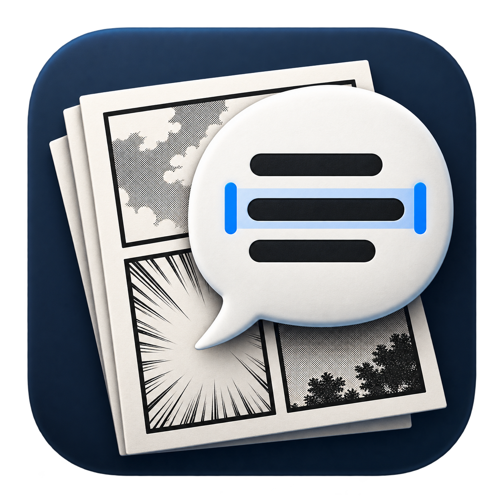

# Inkflow для macOS

Папка PNG/JPG/JPEG → локальный Apple Vision OCR → проверка реплик → TXT главы. Необязательный перевод EN → RU — через Яндекс Переводчик в браузере.

## Запуск

После [сборки из исходников](#разработка) откройте **`dist/Inkflow.app`** двойным щелчком. Для OCR и ручного перевода в собранном приложении Python, терминал и API-ключи не нужны. Апскейл использует отдельную установку nunif. Сборка предназначена для Apple Silicon, macOS 13+. Проверена на M1 Pro с macOS 26.5.2; более старые версии macOS отдельно не проверялись.

1. Нажмите **Открыть папку…** и выберите папку главы. Страницы сортируются по числам в имени: `1, 2, …, 10`; расширения можно смешивать.
2. Нажмите **Распознать главу** или **Распознать страницу**. Обработка идёт по очереди. Остановка завершает текущую страницу; продолжение обрабатывает оставшиеся.
3. Проверьте номера поверх текста. Нажатие на рамку прокручивает список к реплике. Текст справа можно редактировать; стрелки меняют порядок.
4. Снимите **В TXT**, чтобы исключить звук или лишнюю надпись. В меню `…` доступны объединение со следующей репликой, исходный OCR и удаление блока. Кнопка отмены восстанавливает последнюю правку.
5. Если текст пропущен, нажмите **Добавить облачко** и обведите его мышью. Новая реплика добавляется в конец списка; переставьте её стрелками. Если OCR ничего не найдёт, можно ввести текст вручную. Чтобы разделить ошибочно объединённый блок, исключите его и добавьте нужные облачка по отдельности.
6. Нажмите **Отметить как проверенную**, затем **Экспорт TXT…**. По умолчанию файл называется как папка главы, например `155.txt`. Непроверенные и нераспознанные страницы помечаются в TXT.

**Правки сохраняются автоматически** в скрытом файле `.mangascan.json` в папке главы. Имя файла сохранено для совместимости с первой версией приложения. Повторное открытие той же папки восстанавливает текст, порядок, исключённые блоки и отметки проверки. Храните этот файл вместе с изображениями. Если файл проекта повреждён, приложение сообщает об ошибке и не перезаписывает его. Если изображение изменилось, старые правки сохраняются с предупреждением; автоматическая повторная обработка изменённого исходника пока не предусмотрена.

Клавиши: `⌘O` — папка, `⌘S` — сохранение, `⌘E` — TXT, `⇧⌘Z` — отменить правку Inkflow. История отмены сохраняется только до закрытия приложения/смены главы.

## Апскейл ×2 через nunif

Откройте папку и нажмите **Апскейл папки ×2** над изображением. Все PNG/JPG/JPEG главы обрабатываются по очереди с прогрессом. После каждой страницы её рабочее изображение в Inkflow заменяется улучшенным PNG: можно сразу продолжать редактирование и OCR. Выбранная страница, порядок, реплики и переводы сохраняются; отметки проверки снимаются. OCR и ручное выделение областей используют новый вариант.

Результаты сохраняются в `upscaled/<идентификатор запуска>/<имя исходника>_x2.png` внутри папки главы. Оригиналы остаются на диске, а ссылки на рабочие изображения сохраняются в `.mangascan.json` и восстанавливаются при повторном открытии исходной папки. Храните папку `upscaled` вместе с главой. История отмены очищается при смене рабочих изображений. При остановке или ошибке готовые страницы остаются улучшенными, остальные — в прежнем виде; повторный запуск обрабатывает все текущие рабочие изображения ещё раз (снова ×2).

Нужен установленный [nunif](https://github.com/nagadomi/nunif) с зависимостями и скачанными моделями waifu2x. Inkflow автоматически ищет `~/Downloads/nunif` и Python в `.venv/bin/python` или `venv/bin/python`. Если они не найдены, предложит выбрать папку nunif и Python его окружения; выбор сохраняется. Окружение работает отдельно от системного Python, запуск из Finder поддерживается.

Запускается команда с фиксированными параметрами (пути передаются отдельными аргументами):

```sh
python -m waifu2x.cli -i input -o output --method scale2x --noise-level 1 --format png
```

Работа идёт в фоне; кнопка **Остановить** прерывает процесс. Проверяются успешное завершение и удвоение размеров изображения. Модели и зависимости Inkflow автоматически не устанавливает. Повторный запуск сохраняет отдельный результат.

## Удаление текста кистью

После перевода включите **Кисть восстановления** над страницей. Настройте размер в пикселях рабочего изображения, увеличьте масштаб при необходимости и закрасьте текст целиком, захватив небольшой запас фона. По отпусканию мыши закрашенный участок восстанавливается по окружающему фону. По умолчанию выбран режим **Сохранять текстуру**: он подбирает целые соседние фрагменты по границе мазка, сохраняя зерно и растр без усреднения. Для ровных облачков доступен режим **Сглаживать** (OpenCV Telea). Одиночный щелчок оставляет круглый мазок. Рамки OCR скрыты во время ретуши.

Каждый мазок сохраняется отдельным PNG в `edited/` и сразу становится рабочим изображением. Реплики и переводы остаются в проекте. Кнопка со стрелкой рядом с размером кисти или `⇧⌘Z` отменяет последнюю правку, включая мазок. История отмены действует до закрытия приложения/смены главы; текущий результат восстанавливается после повторного открытия. Храните `edited/` вместе с главой. Кнопка с папкой показывает рабочий файл в Finder.

Кисть работает локально через Python окружения nunif и `opencv-python-headless`. Один раз установите зависимость в то же окружение, например:

```sh
~/Downloads/nunif/venv/bin/python -m pip install opencv-python-headless
```

В режиме текстуры возможны повторения узора и неточное продолжение линий; сглаживание может размывать растр. Скрытые буквами детали нельзя восстановить точно по одному изображению. Это восстановление по соседним фрагментам, без генеративной модели. Лучше работать небольшими мазками. Новые режимы применяются к новым мазкам; сохранённые ранее мазки автоматически не пересчитываются. Исходник и предыдущие PNG сохраняются; после стирания OCR не запускается автоматически.

## Текст поверх страницы

Нажмите **Добавить текст** над изображением. Справа откроется вкладка **Текст на странице**: введите или вставьте перевод, выберите установленный шрифт через поиск и настройте слой.

Доступны размер шрифта в пикселях рабочего изображения, ширина и высота букв в процентах, межстрочный и межбуквенный интервалы, цвет, выравнивание, центрирование по высоте, координаты и размеры текстового блока. Изменение числовых полей подтверждается Enter или переходом к другому полю. Строки переносятся по ширине блока; если текст не помещается по высоте, появляется подсказка. Чтобы переместить текст, перетащите его блок мышью во вкладке **Текст на странице**. У выбранной рамки есть восемь маркеров: тяните угол для изменения ширины и высоты или боковой маркер для изменения одной стороны. Текст переносится по новой ширине, размер шрифта сохраняется. Перемещение и изменение рамки отображаются сразу, сохраняются после отпускания мыши и отменяются одной правкой.

Панель начертаний: **B** — жирный, **I** — курсив, **U** — подчёркивание, **S** — зачёркивание, **TT** — все прописные. Переключатели можно сочетать. Форматирование применяется ко всему слою, а не к выделенным буквам. Прописные меняют отображение, сохраняя исходный регистр в поле ввода.

Для B/I выбирается настоящее начертание установленного шрифта. Если его нет, используется искусственная жирность или наклон с пометкой в панели. Для выбора другой насыщенности (например, Light, Medium или Black) используйте список шрифтов с установленными начертаниями. При выборе начертания в списке B/I соответствуют выбранному варианту. Некоторые декоративные шрифты не имеют обычного начертания — в этом случае панель предлагает выбрать другое. Настройки сохраняются в проекте, поддерживают отмену и экспортируются в PNG. Это базовые параметры слоя; полного соответствия панели Character Photoshop и форматирования отдельных фрагментов пока нет.

Можно создать несколько слоёв, выбирать их в списке, скрывать, менять порядок кнопками **Выше / Ниже** и удалять. Новые слои появляются поверх предыдущих. Если перед добавлением выбран блок OCR с переводом, новый слой получает его рамку и перевод. Выбор шрифта включает доступные системные начертания; если шрифт проекта больше не установлен, используется системный с предупреждением.

Слои и настройки автоматически сохраняются в `.mangascan.json`, остаются редактируемыми после открытия главы и поддерживают отмену через `⇧⌘Z`. Апскейл масштабирует положение и типографику пропорционально; ретушь и OCR сохраняют слои. Кисть восстанавливает растровое изображение под слоями, не стирая их текст.

**Экспорт страницы в PNG…** сохраняет выбранную страницу с видимыми текстовыми слоями в полном разрешении, без рамок редактора. Папка по умолчанию — `exports/` внутри главы. Экспорт не меняет рабочее изображение и слои проекта; исходные и рабочие файлы защищены от перезаписи. TXT-экспорт по-прежнему содержит реплики OCR и их переводы. Редактор поддерживает горизонтальный текст без поворота и обводки.

## Перевод на русский через браузер

Эксперимент локального перевода через Ollama/Qwen удалён. Приложение не запускает LLM и не загружает модели. Для перевода используется браузер или ручное редактирование реплик.

1. Распознайте главу и проверьте английские реплики и их порядок.
2. Нажмите **Яндекс Переводчик…**, затем **Скопировать EN и открыть Яндекс**. Откроется [перевод с английского на русский](https://translate.yandex.ru/?source_lang=en&target_lang=ru) в браузере по умолчанию. Вставьте оригинал в левое поле: `⌘V`.
3. Скопируйте русский результат в браузере, вернитесь в Inkflow и нажмите **Добавить перевод из буфера**. Кнопка добавляет текст в конец черновика; правки доступны прямо в поле.
4. Нажмите **Сохранить RU TXT…**. Имя по умолчанию — `155_ru.txt`; английский экспорт `155.txt` остаётся отдельным файлом.

В браузер копируется оригинальный TXT главы с заголовками и порядком реплик, без старых русских переводов. Длинный текст разбивается на части до 9500 единиц UTF-16 с предпочтением границ строк. Выбирайте части по очереди, очищайте предыдущее содержимое слева в Яндексе и добавляйте каждый перевод один раз. Вставка в браузер и копирование результата выполняются вручную; автоматического управления сайтом нет.

Черновик сохраняется автоматически в `.mangascan.json` и восстанавливается при открытии главы. Он не разбивается обратно на облачка и не обновляется при изменении оригинала. Перед экспортом проверьте полноту перевода и имена. Старые переводы отдельных реплик и режимы **Перевод / EN + RU** сохранены для ручной работы; они независимы от черновика Яндекса.

Формат проекта — версия 2, чтение версии 1 поддерживается. Не редактируйте одну главу одновременно в старом и новом приложении.

## Что автоматизировано и где нужна проверка

Распознавание выполняет системный Apple Vision локально и не требует сторонних моделей или интернета. Перевод в Яндексе требует интернета: вставленный текст обрабатывается сервисом Яндекса. Изображения приложение туда не отправляет.

Панели выделяются по светлым промежуткам: сначала горизонтальные разделители, затем вертикальные с обходом справа налево. Строки объединяются по близости и выравниванию внутри панели. Предварительный порядок реплик определяется геометрически. Это **эвристика**, а не модель понимания сюжета или полноценный детектор границ облачков.

Ограничения:

- Нестандартные, вложенные, диагональные панели, развороты и облачка поверх нескольких панелей могут определяться неверно.
- Смысл диалога не анализируется. Иногда порядок реплик невозможно восстановить одной геометрией.
- Фоновые надписи и звуки не удаляются автоматически: их нужно исключить вручную.
- OCR может путать буквы, пунктуацию и имена даже при высокой уверенности. Некоторые похожие кириллические символы заменяются латинскими и отмечаются предупреждением; исходный текст доступен в меню блока.
- Обрабатываются файлы непосредственно в выбранной папке, без обхода вложенных папок.
- Прототип хранит правки рядом с исходниками; папка должна быть доступна для записи. Один проект следует редактировать в одном окне/экземпляре приложения.

## Проверка на пяти образцах

Автоматические результаты находятся в `output/automatic.json`, сравнение — в `output/evaluation.json`. Таблица обновлена по локальному прогону 30 октября 2026 года.

| Образец | Найдено размеченных блоков | Всего блоков OCR | Порядок реплик относительно ручного образца |
|---|---:|---:|---|
| 01 | 8/8 | 8 | Совпал |
| 02 | 8/8 | 8 | Совпал |
| 03 | 5/5 | 7 | Совпал |
| 04 | 5/5 | 6 | Совпал |
| 05 | 8/8 | 8 | Требует правки |

Сопоставление блоков проверяется по пересечению рамок (IoU ≥ 0,55); сравнение порядка исключает лишние блоки звуков и фона. **Это не оценка точности букв и не гарантия качества на новых главах.** Пять страниц использовались при разработке. Предполагаемый порядок на странице 05 в ручном образце выбран по смыслу диалога и требует подтверждения редактором. На странице 02 геометрический детектор создаёт одну лишнюю область панели, хотя порядок размеченных реплик сохраняется.

Проверены: объединение строк, порядок несимметричных панелей, числовая сортировка, OCR всех образцов и выделенной области, сохранение и восстановление, изменение текста/порядка, исключение, объединение, удаление, отмена, отметки проверки, сохранность правок при повторной обработке. Через интерфейс отдельной тестовой копии проверены импорт пяти страниц, пакетное OCR, редактирование, перестановка, исключение, отметка проверки и экспорт; содержимое TXT и сохранённого проекта сверено с выполненными действиями.

## Разработка

Исходники приложения: `App/Core.swift`, `App/Model.swift`, `App/Inkflow.swift`, `App/Upscale.swift`, `App/Healing.swift`, `App/TextLayers.swift`. Сборка использует SwiftUI, AppKit, Vision и ImageIO без внешних зависимостей.

```sh
./scripts/build.sh
./scripts/test.sh
# Дополнительно: проверка кисти через реальный Python с OpenCV
INKFLOW_HEALING_PYTHON=~/Downloads/nunif/venv/bin/python ./scripts/test.sh
```

Для сборки нужны инструменты разработчика Apple со Swift. Основные тесты создают синтетические изображения и не требуют страниц манги. Локальный набор из пяти образцов и сравнение с ручной разметкой запускаются отдельно: `INKFLOW_PRIVATE_SAMPLES=1 ./scripts/test.sh` (нужны локальные `samples/`, файлы разметки в `output/` и Python 3). Приложение подписывается локальной ad-hoc подписью; это не нотарифицированный дистрибутив для распространения.

Документация: [распознавание текста Apple Vision](https://developer.apple.com/documentation/vision/recognizing-text-in-images), [SwiftUI](https://developer.apple.com/documentation/swiftui).

## Материалы и репозиторий

Публичный репозиторий: [Genoshi14X/inkflow](https://github.com/Genoshi14X/inkflow). Он содержит исходники, иконку и скрипты сборки. Папки `samples/`, `output/`, `dist/`, `bin/`, сохранённые проекты и локальные настройки исключены из Git. Описанные ниже экспериментальные материалы существуют только локально и не входят в репозиторий.

Иконка автоматически собирается в формат macOS при запуске `scripts/build.sh`. [Исходник и промпт](docs/icon.md).

## Первый эксперимент

`Sources/ocr.swift` и `scripts/report.py` сохранены отдельно. `output/review.html`, `output/verified.txt` и `output/reference.json` содержат **ручную** проверку исходного эксперимента и не являются результатом автоматического алгоритма. `samples/01.png`–`05.png` — копии вложений в порядке отправки, не номера страниц главы.
